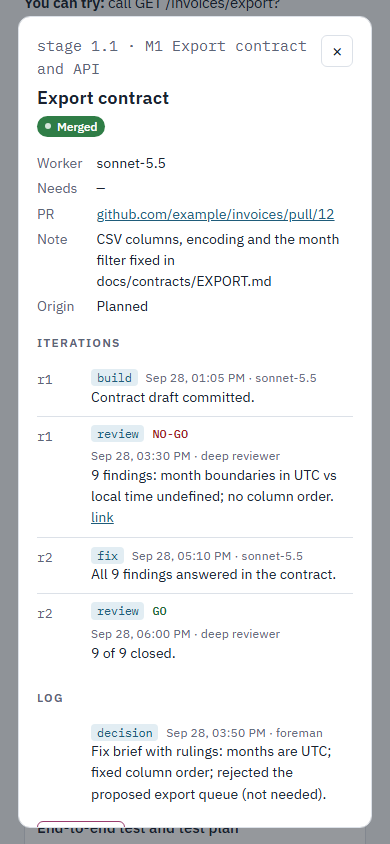

# foreman

A Claude Code skill for running an agreed plan through delegated AI agents while the owner stays in charge.
The foreman splits the plan into milestones and stages, routes each stage to the right worker, checks every
piece itself, keeps a live progress dashboard, and hands the owner something he can actually run: a test plan
per milestone. It never builds the code itself, and nothing merges without the owner's word.

## Install

Copy this folder to `~/.claude/skills/foreman/` (the files that matter at run time are `SKILL.md`,
`defaults.yaml`, `dashboard/`, and optionally your own `LOCAL.md`). It loads at the next session start and
triggers on requests like "take this plan and build it", "orchestrate this", "run it overnight", "where is the
work?", or "give me a test plan".

**Requirements**

- Claude Code with the Agent tool (subagents). That alone is enough to run the whole flow with Claude models.
- `git` and, for stage PRs, the GitHub CLI (`gh`) signed in.
- Optional: other coding-agent CLIs (opencode, Codex, Gemini) if you want to route stages to other models.
- Optional, for the dashboard: a claude.ai account where Artifacts with runtime capabilities (`db`, `user`) are
  available, and the Artifact / ArtifactData tools in Claude Code.

## The flow

```
PLAN ──► MILESTONE 1 ──► MILESTONE 2 ──► ...        each milestone = one PR, stacked
           ├── stage 1.1                             each stage = one real PR into its milestone
           ├── stage 1.2
           └── stage 1.3
```

1. **Run sheet.** The foreman reads the plan, copies `defaults.yaml`, fills it in for the job (arrangement,
   branching, gates, workers, reviewers, environment) and **stops until the owner says yes**.
2. **Plan files.** A master `PLAN.md` plus one `M<n>_PLAN.md` per milestone. Each stage section in the
   milestone file is a copy-paste brief: goal, exact files, steps, and numbered success criteria.
3. **Stage loop.** Dispatch one worker with the brief → verify from git and by running things (never trust the
   worker's report) → gate (self-review, a tester, or a council, by size) → review findings go on the PR as a
   comment → a fix round is a new brief carrying the foreman's **rulings** (the smallest mechanism that closes
   each finding) → re-review → stage PR marked *ready*, not merged.
4. **Test plan.** A milestone is done when the owner can sit down and try it. `TEST_PLAN_M<n>.md`: where the
   work is, what changed, numbered steps with expected results, a cost label on every step
   (`free` / `paid (~$X)` / `do-not-run`), which steps write to which database, and known gaps. The foreman
   runs the whole plan itself first.
5. **Merge** only on the owner's explicit word, stage by stage and milestone by milestone.

Every brief, review and report lives in one run folder per milestone,
`_runs/<YYYY-MM-DD>-M<n>/{briefs,reports,evidence}`, which is never committed.

## Agents and how they are managed

| Role | What it does | Typical routing |
|---|---|---|
| Foreman | Splits the work, writes briefs, verifies, gates, writes test plans, keeps the dashboard. Never writes product code. | The Claude Code session you talk to |
| Workers | Build one stage each from a brief. | Routed by the brain the stage needs: UI, fully specified work, bulk edits, hard thinking |
| Advisor | Consulted before the stage split is locked and before any contract others build on. | The deepest thinker you have |
| Reviewers / judges | Gate a stage or a milestone; write findings with evidence. | Per gate type in the run sheet; `council-judge` panel for large gates |
| Tester | Executes the project's own test skill against the running app. | A subagent with a browser |

How they are managed:

- **Routing is in the run sheet** and is the owner's call. Every model name is version-suffixed and checked
  live. Where a row offers alternatives, the foreman says which it picked and why. Reviewer routing may change
  mid-run; the change is written to the run sheet and logged on the dashboard.
- **Briefs** are written with `subagent-discipline`: plan excerpt, exact files, the acceptance check the worker
  runs, the project's standing rules, "do not commit unless told", and "if anything deviates, stop and report".
- **Verification is never delegated.** The foreman reads `git status`/`git log`/the diff, re-runs the success
  criteria, and runs the app. Workers report false successes and false failures.
- **Grading.** After each run the worker gets an evidence-based scorecard (`subagent-discipline`), so routing
  improves with a track record instead of intuition.
- **Limits.** At most two heavy agents at once; a blocked stage stops that stage, not the run.

## The dashboard

`dashboard/tracker.html` is a ready template for a live progress page. Publish it once as a claude.ai Artifact
with the `db` and `user` capabilities, seed it from the run sheet, and the foreman updates it at every stage
transition and every build / review / fix round.


- Milestones as sections with a progress bar; stages inside them with status colours; a dependency graph; the
  current focus and what is waiting on the owner in the header; an overall activity log.
- **Click any milestone or stage** for a detail panel: its fields, its iterations (build r1, review r1 NO-GO,
  fix r2, review r2 GO, with links to the PR comments), and its own log.
- **Added after planning** stages and milestones get a distinct colour and an `added` label, with the reason.
- **Add in between from the page:** "+ add stage here" between stages, "+ add milestone" between milestones,
  "Add note" in a detail panel. Each is a short form plus a review step; nothing is written until Save.
- Works at phone width, in light and dark themes, and by keyboard. Opened outside claude.ai it offers
  **Show sample data** (or open `tracker.html?demo` locally).



The data contract, every write the foreman makes, and the publish recipe are in
[`dashboard/SCHEMA.md`](dashboard/SCHEMA.md). [`dashboard/seed-example.json`](dashboard/seed-example.json) is a
working seed (two milestones, five stages, a NO-GO review and its fix round, one added stage).

## Related skills

The foreman calls these when they are installed and does their job by hand when they are not:

| Skill | Used for | Without it |
|---|---|---|
| `subagent-discipline` | Every brief and every post-run scorecard | Write the brief to the checklist above; note the worker's performance in the run folder |
| `council-judge` | Multi-judge gates for large stages and milestones | One reviewer subagent at max effort, findings with evidence |
| `verified-pr` | PR mechanics and review-gated pushes | Plain `gh pr create`, findings as a PR comment |
| `visual-planning` | Making a big plan readable for the owner | A plain Markdown plan |
| The project's test skill | What the tester executes | The tester follows the test plan by hand |

## Files

| File | Purpose |
|---|---|
| `SKILL.md` | The skill itself: rules, flow, red flags. This is what loads into a session. |
| `defaults.yaml` | The run-sheet template, generic. |
| `dashboard/tracker.html` | Progress page template. |
| `dashboard/SCHEMA.md` | Tracker data contract, foreman writes, publish recipe. |
| `dashboard/seed-example.json` | Sample seed batch. |
| `LOCAL.md.example` | Shape of the optional per-owner overlay (routing, accounts, paths). Copy to `LOCAL.md`. |

## License

MIT, see `LICENSE`.
