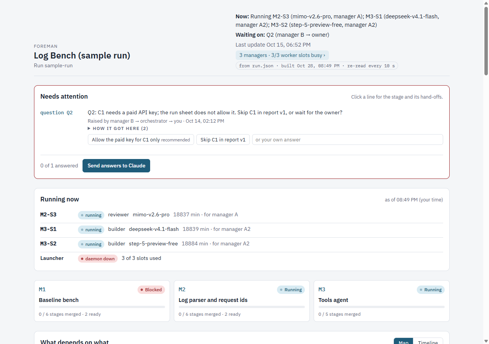
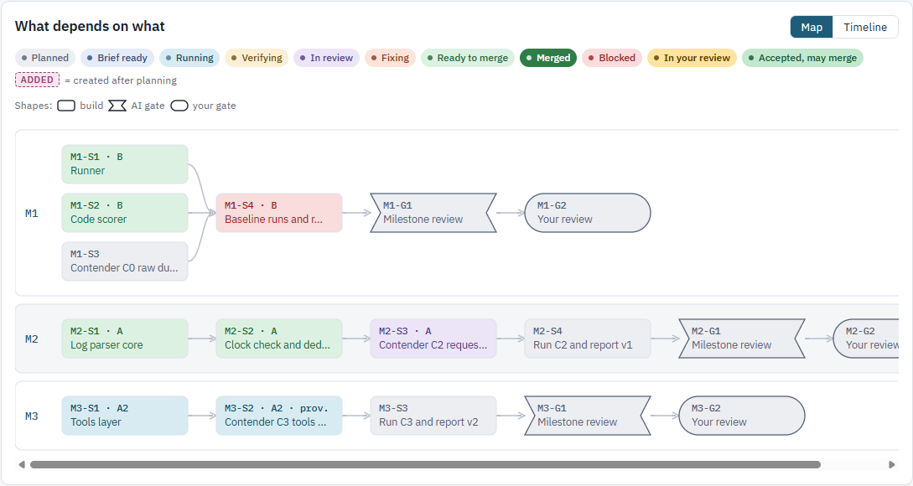

# foreman

An agent skill for running an agreed plan through delegated AI agents while you stay in charge.

The foreman splits the plan into milestones and stages, routes each stage to the right worker, checks every
piece itself, and hands you something you can try: a test plan, and at each milestone a review packet. It never
writes the product code, and nothing reaches your base branch without your word.

Written for Claude Code; it also runs under codex, opencode and Gemini CLIs with the fallbacks below.

## See it first

```
python -m pip install pyyaml    # for the same python you run the scripts with
python track-mode/live.py serve --coord track-mode/sample-run/_coord
```

Open the printed `http://127.0.0.1:8765/`. That is the live tracker drawn from a recorded sample run: milestones,
the stage map, managers and their agents, open questions. Open `dashboard/packet.html` in a browser for the
review packet with its built-in sample.





## Install

```
python install.py                      # Claude Code -> ~/.claude/skills/foreman
python install.py --harness agents     # codex, opencode -> ~/.agents/skills/foreman
python install.py --harness all        # both
python install.py --dest <dir>         # any other harness: the folder that will hold SKILL.md
```

It copies only the files a session uses (not tests or the sample run), never touches your `LOCAL.md`, and re-running
it updates the install. Start a new session afterwards.

It triggers on requests like "take this plan and build it", "foreman init", "orchestrate this", "run it
overnight", "where is the work?" or "give me a test plan".

Optional: copy `LOCAL.md.example` to `LOCAL.md` beside `SKILL.md` and put your own worker routing, accounts (env
var names only) and house rules there. The skill reads it first. It is gitignored.

### Requirements

| For | You need |
|---|---|
| The skill itself | an agent harness that can start subagents or other agent CLIs; `git` |
| Stage and milestone PRs | the GitHub CLI (`gh`), signed in |
| `evals/plan_check.py`, `track-mode/live.py` | Python 3.9+ (tested on 3.12) and PyYAML |
| `track-mode/launcher.py` (worker pool for long runs) | **Windows**, and the `opencode` CLI signed in. It drives opencode workers only. |
| The phone-friendly tracker and answering questions on the page | Claude Code with claude.ai Artifacts (`dashboard/SCHEMA.md`) |

## How a run goes

```
PLAN ──► MILESTONE 1 ──► MILESTONE 2 ──► ...        each milestone = one PR you review, stacked
           ├── stage M1-S1                           each stage = one PR into its milestone
           ├── stage M1-S2
           ├── gate  M1-G1  (AI review)
           └── gate  M1-G2  (your review)
```

1. **`foreman init`.** It reads your plan, does an architect pass (critical path, parallel tracks, who builds
   what), writes a run sheet from `defaults.yaml`, `_coord/plan.yaml`, `PLAN.md` and one `M<n>_PLAN.md` per
   milestone, asks its setup questions in one batch, and **stops until you say yes**. Say "init and start" to
   skip only that wait.
2. **Milestones are working slices**: each one is a feature you can use end to end, with `adds` and `done_when`
   in your words. Uncertain work goes into an *explore* milestone off to the side (`references/explore.md`).
3. **Stage loop.** One worker per stage, from a copy-paste brief → the foreman verifies from git and by running
   things (never from the worker's report) → stage review, findings posted on the PR → a fix round is a new
   brief carrying the foreman's rulings → once the gate passes, the stage merges into its milestone branch.
4. **Gates.** Each milestone ends with an AI gate, then your gate (`references/gates.md`). At your gate you get a
   review packet (`references/packet.md`) and a test plan whose every step is labelled `free`, `paid (~$X)` or
   `do-not-run`. The foreman runs the whole test plan itself first.
5. **You merge milestones.** The foreman never merges a milestone or touches the base branch on its own judgment,
   and never writes to production without your say-so, every time.

Long runs with several parallel tracks switch to **track mode**: the session becomes an orchestrator, each track
gets a manager, and workers start through the launcher (`track-mode/CHARTER.md`, `track-mode/LAUNCHER.md`).
Every hand-off is one JSON line in `_coord/events/`, which is what the live view draws.

## One core, one file per harness

`SKILL.md` holds every rule and names no harness tool. Seven steps depend on the harness: starting a worker or
manager, waking when a job hands back, scheduled check-ins, showing you the run, taking your answers, resuming a
manager and sending you updates, and naming models. The skill reads one file for those:

| File | For | How it does the seven |
|---|---|---|
| `harness/claude-code.md` | Claude Code | subagents, Monitor, scheduled check-ins, the tracker as a claude.ai Artifact you can answer on |
| `harness/generic.md` | everything else | separate agent CLI runs, polling between steps, `live.py serve`, answers in chat or `questions.md` |

On other harnesses the run moves only while a session is open. A native file for another harness (say codex) is
one more page in `harness/` holding the same seven steps; the rules never move out of `SKILL.md`.

## Companion skills (optional)

The foreman uses these when they are installed and does their job by hand when they are not. They are separate
skills, not part of this repo.

| Skill | Used for | Without it |
|---|---|---|
| `delegation` | Preparing each worker's worktree, its mailbox and progress files, soft and hard stops | `git worktree add` per stage; three `_scratch/` files described in `track-mode/LAUNCHER.md` |
| `subagent-discipline` | Writing briefs and grading each worker afterwards | Briefs follow `SKILL.md`; a few lines per worker in the run's `reports/` |
| `council-judge` | Multi-model review for large gates | One strong reviewer that did not build the stage |
| `verified-pr` | PR mechanics | Plain `gh pr create`, findings as a PR comment |

## Files

| Path | What it is |
|---|---|
| `SKILL.md` | The skill: rules, flow, red flags. This is what loads into a session. |
| `harness/` | How the seven harness-dependent steps work in Claude Code, and everywhere else. |
| `install.py` | Copies the run-time files into a harness's skills folder. |
| `defaults.yaml` | The run-sheet template. |
| `profiles/default.yaml` | Example model routing with pre-approved fallbacks; fill in your own. |
| `references/` | Read on demand: gates and plan shape, explore milestones, the review packet. |
| `dashboard/` | `tracker.html` (live tracker), `packet.html` (review packet), `SCHEMA.md` (data contract and Artifact recipe), `seed-example.json`. |
| `track-mode/` | `live.py` (builds and serves the tracker data), `launcher.py` (worker pool), `CHARTER.md`, `LAUNCHER.md`, `usage_split.py` (Claude Code usage per session), `sample-run/`. |
| `evals/` | `plan_check.py` (checks a `plan.yaml`), `scenarios.py` (scripted gate scenarios), `study.py` (compare skill versions), rehearsal notes. |
| `LOCAL.md.example` | Shape of your private overlay. |

## Tests

```
python track-mode/test_live.py
python track-mode/test_launcher.py     # Windows only
python evals/scenarios.py selftest
python evals/plan_check.py track-mode/sample-run/_coord/plan.yaml
python install.py selftest
```

## License

MIT, see `LICENSE`.
